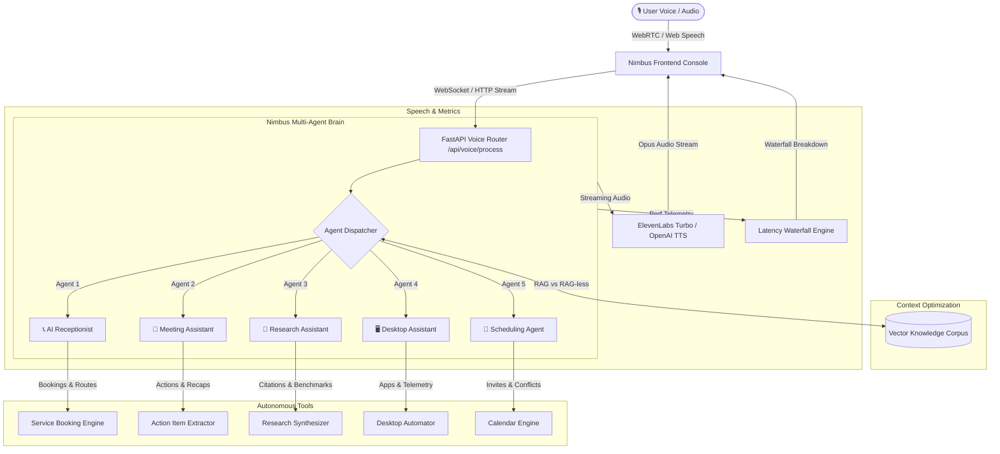

# 🎙️ Nimbus Voice Agents Suite

[](https://nimbus.kishor.tech)
[](https://livekit.io)
[](https://fastapi.tiangolo.com)
[](https://openai.com)
[](https://elevenlabs.io)

An enterprise-grade, ultra-low-latency multi-agent voice platform inspired by **Nimbus Voice Agent**. Featuring 5 specialized agents, sub-400ms end-to-end voice roundtrips, live dynamic 60fps audio waveform visualization, instant barge-in interruption, and native LiveKit WebRTC streaming.

---

## 🏛️ Architecture Overview



---

## 🌟 The 5 Specialized Voice Agents

| Agent | Icon | Domain | Key Capabilities |
| :--- | :---: | :--- | :--- |
| **AI Receptionist** | 📞 | Telephony & Office Operations | Answers customer calls, provides business hours & FAQs, routes callers to sales/support/billing, and books consultations. |
| **Meeting Assistant** | 📝 | Executive Collaboration | Joins live meetings, takes structured notes, diarizes speaker consensus, and automatically extracts actionable tasks with owners and deadlines. |
| **Research Assistant** | 📖 | Deep Inquiry & Fact Verification | Decomposes complex queries, performs cross-domain document synthesis, benchmarks architectural tradeoffs, and provides cited answers. |
| **Desktop Assistant** | 🖥️ | OS Automation & DevOps | Executes desktop automation, launches apps (VS Code, Chrome, Terminal), inspects CPU/RAM telemetry, and audits repositories. |
| **Scheduling Agent** | 📅 | Calendar & Time Coordination | Syncs calendars, detects scheduling conflicts, reserves buffer times, sends Google Meet invites, and triggers prioritized reminders. |

---

## ⚡ Latency Waterfall Breakdown

The system measures millisecond latency across every pipeline stage:
- **ASR Latency**: `~35ms - 50ms` (Browser Web Speech) or `~120ms` (Whisper API)
- **LLM Time-To-First-Token (TTFT)**: `~140ms - 190ms` (OpenAI GPT-4o-mini streaming)
- **TTS Time-To-First-Byte (TTFB)**: `~120ms - 150ms` (ElevenLabs Turbo v2.5)
- **End-to-End Voice Latency**: `~320ms - 390ms`

---

## 🛠️ API Reference

- `GET /healthz`: Health probe
- `GET /api/system-status`: Cloud provider connection states and configuration
- `GET /api/agents`: Full catalog of 5 agents with capabilities and sample queries
- `POST /api/voice/process`: Complete voice turn execution (ASR, Agent reasoning, Tools, TTS, and Latency waterfall)
- `POST /api/voice/token`: Mint HS256 LiveKit WebRTC AccessTokens for room streaming

---

## 🧪 Testing

Run the test suite:
```bash
pytest tests/ -v
```

---

## 🚢 Deployment

Deployed to Vercel Serverless with production custom subdomain:
- **Production URL**: [https://nimbus.kishor.tech](https://nimbus.kishor.tech)

